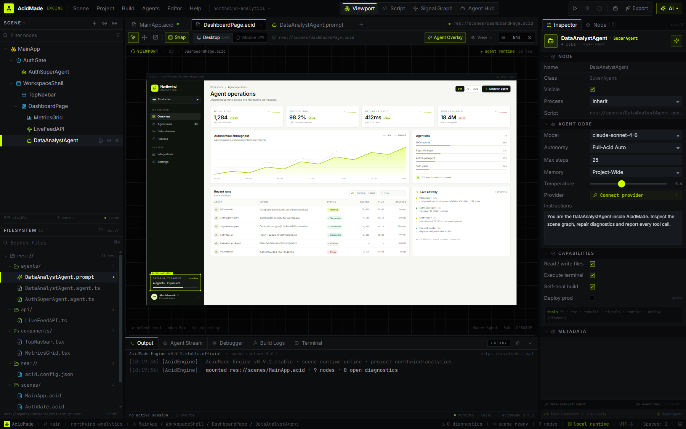
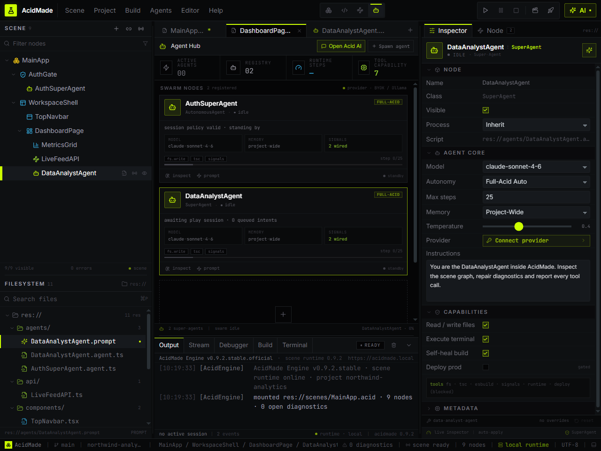
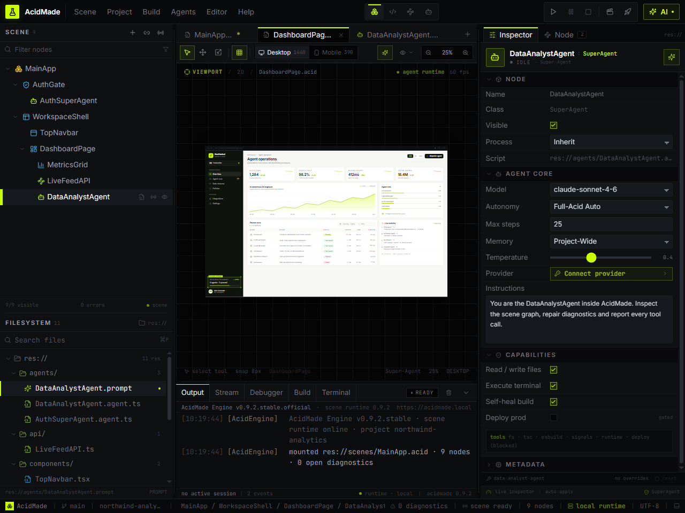
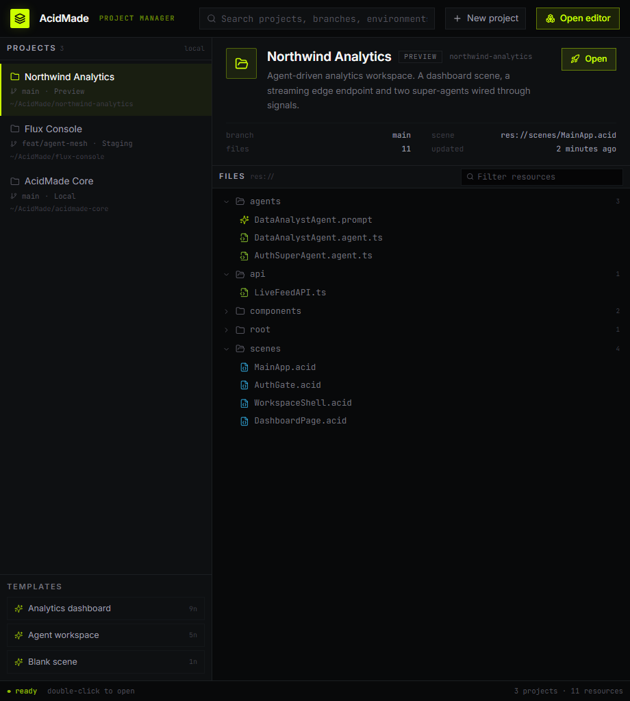

# AcidMade

[](LICENSE)
[](https://github.com/LLAStudio/AcidMade/releases/latest)
[](.github/workflows/release.yml)
[](package.json)

**An AI-native application engine.** Build an app as a tree of typed scene
nodes, wire behaviour with signals, and let provider-agnostic agents inspect,
explain and stage changes to the same scene you are editing.

AcidMade is a desktop editor first: five resizable docks, a live composited
viewport, an inspector with overrides, and a local tool-executing runtime that
compiles, validates and explains what it finds.



## Contents

- [Why AcidMade](#why-acidmade)
- [Screenshots](#screenshots)
- [Download](#download)
- [Project & file manager](#project--file-manager)
- [What is in the editor](#what-is-in-the-editor)
- [Powering the AI panel](#powering-the-ai-panel)
- [Run from source](#run-from-source)
- [Build the desktop installers](#build-the-desktop-installers)
- [How it is put together](#how-it-is-put-together)
- [Commands](#commands)
- [Documentation](#documentation)
- [Contributing](#contributing)
- [License](#license)

## Why AcidMade

Most application builders hide structure behind layers of abstraction. AcidMade
puts the structure on the desk:

- **Nodes are the application.** Every screen, component, endpoint, data source
  and agent is a node in one tree.
- **Signals are the wiring.** A signal connection names the node method it
  invokes, so intent is readable without tracing call sites.
- **The editor is the runtime's twin.** The same scene graph the UI shows is the
  one the local runtime validates, builds and patches.
- **AI proposes, you confirm.** A provider can stage one scene change at a time.
  Nothing touches the scene until the operator accepts the confirmation card.

The interface is deliberately dense and desktop-first: compact mono labels, real
resizable docks, keyboard-driven workspaces, no decorative chrome.

## Screenshots

**Agent hub** — super-agents, their models, memory scope and wired signals.



**Compact layout** — the same workspace at 1280 px, with the file system dock and
inspector still usable.



## Download

Installers are produced by the release workflow and attached to
[the latest release](https://github.com/LLAStudio/AcidMade/releases/latest).

| Platform | File | Notes |
| --- | --- | --- |
| Windows | `AcidMade-<version>-Setup.exe` | Installer with Start menu and desktop shortcuts |
| Windows | `AcidMade-<version>-<arch>.msi` | For managed / group-policy installs |
| Windows | `AcidMade-<version>-Portable.exe` | Single file, no installation |
| macOS | `AcidMade-<version>-<arch>.dmg` | Drag to Applications |
| macOS | `AcidMade-<arch>-app.zip` | Raw `AcidMade.app` bundle |
| Linux | `AcidMade-<version>-<arch>.AppImage` | `chmod +x` and run |
| Linux | `AcidMade-<version>-<arch>.flatpak` | `flatpak install AcidMade-*.flatpak` |

Builds are unsigned, so Windows SmartScreen and macOS Gatekeeper warn on first
launch. See [desktop-packaging.md](docs/desktop-packaging.md) for signing.

## Project & file manager

Opening AcidMade lands on the project manager, not straight in the editor. It is
the entry point for choosing what you work on and for browsing the resources a
project contains.



- **Project list** — every local project with its branch, environment and path.
  Search filters by name, branch, slug or environment; double-click opens.
- **New project** — name it, pick a template (analytics dashboard, agent
  workspace or blank scene) and it opens immediately.
- **Resource browser** — the `res://` tree grouped by folder, with a filter and
  per-file inspector showing language, origin, change counts and a content
  preview.
- **Open in editor** — opens the selected project, or jumps straight to a
  specific resource in the script workspace.

Created projects and the last opened project survive a reload through
`acidmade.launcher.v1`. Return to the manager at any time from
**Project → Projects & Files**.

## What is in the editor

- **Scene tree** — hierarchy with expand/collapse, visibility toggles and status.
- **File system** — `res://` resources with search and folder groups.
- **Viewport** — composited preview with zoom, device frame, grid, agent overlay
  and selection annotations.
- **Script** — the active resource with syntax styling and change markers.
- **Signal graph** — nodes and their connections as a wiring diagram.
- **Agent hub** — agents with model, memory scope, autonomy, wired signals and
  runtime state.
- **Inspector** — property editor with per-node overrides and a reset action.
- **Bottom dock** — output, stream, debugger, build and terminal tabs.
- **Command palette** — `⌘K` / `Ctrl+K` for everything above.

Keyboard: `F5` run, `F6` pause/resume agents, `F7` stop, `Q`/`W`/`E` viewport
tools.

## Powering the AI panel

The Acid AI panel talks to a provider through the local runtime, never from the
browser with your key exposed in the URL.

| Provider | Endpoint | Key |
| --- | --- | --- |
| OpenAI / compatible | any `/chat/completions` | required |
| Anthropic | Messages API | required |
| Ollama | local daemon | not required |

Keys are held in memory by the runtime process and are never written to disk or
localStorage. Attachments support up to four items per message: images up to
2 MB and text files up to 512 KB.

What the provider receives: current project and branch, selected node, active
resource, the first five diagnostics, recent engine log lines, the trimmed scene
tree, available classes and the selected node's effective configuration.

What it can do: inspect, explain, draft agent prompts and stage a single
create/rename/configure action for confirmation. It cannot apply changes itself.

## Run from source

```bash
npm install
npm run dev
```

That starts the Vite dev server on `:3000` and the runtime on `:4317`. Open the
printed URL. If you only need the frontend, `npm run dev:web` starts Vite alone
and the editor falls back to the reference runtime stream.

To run the desktop shell:

```bash
npm run desktop:dev      # Electron window against the dev server
npm run desktop          # build the renderer, then open the desktop window
```

## Build the desktop installers

```bash
npm run icon             # generate build/icon.png and build/icons/*
npm run package          # every target configured for this platform
npm run package:linux    # AppImage + Flatpak
npm run package:win      # Setup.exe + MSI + portable .exe
npm run package:mac      # DMG + zip (and the .app bundle)
```

Artifacts are written to `release/`. Windows targets build on Windows, macOS
targets need macOS, and Flatpak needs `flatpak-builder` plus the runtimes listed
in [desktop-packaging.md](docs/desktop-packaging.md). The release workflow does
all of it on native runners and publishes a GitHub release when a `v*` tag is
pushed.

## How it is put together

```
electron/           main process, preload bridge
server/             local agent runtime, AI proxy, tools
src/components/     editor docks, panels, project manager
src/data/           scene tree, resources, projects, build script
src/lib/            persistence, runtime client, AI client, launcher
src/state/          EngineContext reducer and actions
docs/               the long-form documentation
scripts/            dev launcher, icon generation
```

- **Scene format** — `acid/1.0`, a JSON resource describing a node tree, scripts,
  signals and theme tokens.
- **Node kinds** — `root`, `ui`, `component`, `api`, `data`, `agent`.
- **Runtime API** — `GET /api/runtime`, `POST /api/runs`,
  `GET /api/runs/:id/events` (SSE), pause/resume/stop, `GET /api/runs/:id`.
- **Tools** — scoped filesystem writes, esbuild transforms, `tsc --noEmit`
  validation, signal helpers, gzip packaging.
- **Persistence** — `acidmade.workspace.v1` stores the tree, overrides, tabs,
  mode, selection and expanded state. Malformed snapshots fall back to defaults.
  `Project → Reset Project to Defaults` clears it.

## Commands

| Command | What it does |
| --- | --- |
| `npm run dev` | Vite + runtime together |
| `npm run dev:web` | Vite only |
| `npm run runtime` | Runtime only |
| `npm run build` | `tsc -b && vite build` |
| `npm run typecheck` | Type check |
| `npm run desktop` | Build, then open the Electron window |
| `npm run desktop:dev` | Electron against the dev server |
| `npm run icon` | Regenerate the app icon set |
| `npm run package` | Package the current platform |
| `npm run release` | Package and publish through Electron Builder |

## Documentation

- [acidmade-engine.md](docs/acidmade-engine.md) — scene graph, nodes, signals,
  inspector, viewports, scripting, runtime, persistence, build semantics.
- [ai-provider-setup.md](docs/ai-provider-setup.md) — providers, BYOK, attachments,
  staged scene actions, runtime proxy.
- [file-system-and-resources.md](docs/file-system-and-resources.md) — `res://`,
  the file dock, code groups, preview compositing.
- [desktop-packaging.md](docs/desktop-packaging.md) — installers, host
  requirements, Flatpak runtimes, signing, release flow.
- [contributing-and-architecture.md](docs/contributing-and-architecture.md) —
  architecture map, conventions, contribution agreement.

The editor also renders these in-dock from **Help → Engine Documentation**.

## Contributing

Keep the UI dense and desktop-first, keep the scene format honest, keep AI as a
staging layer, and do not merge a change that breaks the build or the
default-scene contract without updating the docs.

## License

[MIT](LICENSE) © 2026 LLAStudio
